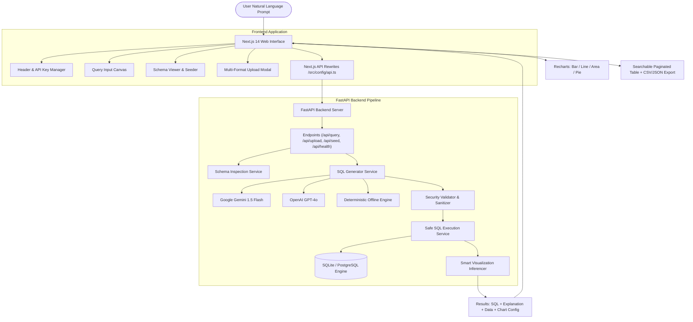

# Enterprise Autonomous Text-to-SQL Analytics Platform 🚀

[](https://fastapi.tiangolo.com)
[](https://nextjs.org)
[](https://python.org)
[](https://www.typescriptlang.org)
[](https://tailwindcss.com)
[](https://recharts.org)
[](LICENSE)

An enterprise-grade, production-ready Text-to-SQL Analytics platform that converts natural language questions into safe, executable ANSI SQL queries. Equipped with dynamic schema inspection, plain-English query explanations, strict read-only execution security sandboxing, multi-format dataset ingestion (10+ formats), and intelligent data visualizations (charts & interactive tables).

---

## 🌟 Key Features

### 1. 🤖 Dual-LLM & Deterministic Offline Fallback Engine
- **Google Gemini 1.5 Flash**: Fast, high-token context window with native JSON schema outputs.
- **OpenAI GPT-4o / GPT-4o-mini**: Robust reasoning for complex SQL joins and multi-level aggregations.
- **Deterministic Analytics Engine**: Zero-config offline intelligence requiring **no external API keys**. Reliably interprets common analytical queries (revenue trends, customer segmentation, audit logs, regional breakdowns) out-of-the-box.
- **Live In-App API Key Manager**: Switch between Gemini, OpenAI, or the offline deterministic engine in real-time, complete with instant connectivity tests.

### 2. 📁 Universal Multi-Format Dataset Upload (10+ Formats)
Upload custom datasets via an intuitive drag-and-drop modal. The platform automatically normalizes schema columns, registers tables in the database, and readies them for querying:
- **Tabular Data**: `.CSV`, `.TSV`, `.TXT` (Tab or custom delimited)
- **Spreadsheets**: `.XLSX`, `.XLS` (Excel workbooks with multi-sheet support)
- **Structured Data**: `.JSON` (Array of objects or nested JSON structures)
- **Database Files**: `.DB`, `.SQLITE`, `.SQLITE3` (Full multi-table SQLite databases)
- **SQL Dumps**: `.SQL` (Direct DDL / DML scripts)
- **Big Data Formats**: `.PARQUET` (Apache Parquet datasets via PyArrow)

### 3. 🛡️ Strict Security Sandboxing & Safe Execution
- **Strict Read-Only Enforcement**: Executes only `SELECT`, `WITH` (CTEs), and `EXPLAIN` queries.
- **Keyword Blocklist**: Proactively blocks destructive and data-altering SQL operations (`DROP`, `DELETE`, `UPDATE`, `INSERT`, `ALTER`, `TRUNCATE`, `EXEC`, `CREATE`, `ATTACH`, `PRAGMA`, etc.).
- **Multi-Statement Attack Prevention**: Rejects query chaining using semicolons to protect database integrity.
- **Human-Readable Error Normalization**: Translates raw database driver errors (e.g. missing tables, missing columns, syntax errors) into clear, actionable advice.
- **Execution Performance Profiling**: Measures query execution timing down to milliseconds.

### 4. 📝 Plain-English Query Explanations & SQL Studio
- **Transparent Query Explanations**: Accompanies each generated SQL statement with a plain-English explanation detailing the tables joined, filters applied, and aggregation logic.
- **Interactive SQL Studio**:
  - One-click copy-to-clipboard.
  - Live inline SQL editor allowing power users to modify generated queries.
  - Safe re-execution button to run customized queries with immediate visual feedback.

### 5. 📊 Dynamic Visualizations & Data Export
- **Smart Chart Recommendation**: Evaluates returned column data types and cardinality to select the optimal view:
  - **Bar Charts**: Categorical comparisons and metrics.
  - **Line / Area Charts**: Temporal data (dates, time series, monthly trends).
  - **Pie Charts**: Small category proportions, market shares, and plan distributions.
  - **Data Table**: Fallback tabular representation.
- **Interactive Data Explorer**: Instant search filter, column sorting, and pagination.
- **One-Click Export**: Download raw query results in **CSV** or **JSON** format.

### 6. 🗄️ Relational Enterprise Sample Schema
Pre-configured with a rich SQLite enterprise database (`enterprise_analytics.db`) featuring 4 interconnected tables:
- `customers`: Customer profiles, subscription plans (`Enterprise`, `Pro`, `Standard`), countries, and total spend.
- `products`: Product catalog, categories, pricing, stock levels, and ratings.
- `sales`: Transaction history, quantities, total revenues, regions, dates, and order status.
- `audit_logs`: Security and access logs, IP addresses, action types, and status flags.
- **Schema Explorer & Reset**: Live modal to browse active database tables, columns, data types, and sample records, with a one-click database re-seed button.

---

## 🏗️ System Architecture



---

## 📁 Repository Structure

```
Autonomos Text-to-SQL Analytics/
├── backend/
│   ├── api/
│   │   └── index.py               # Vercel serverless entrypoint
│   ├── app/
│   │   ├── db/
│   │   │   ├── database.py        # SQLAlchemy engine & session manager
│   │   │   └── seed.py            # Enterprise schema seeder (customers, products, sales, audit_logs)
│   │   ├── services/
│   │   │   ├── __init__.py        # Service exports
│   │   │   ├── pipeline.py        # TextToSqlPipeline coordinator
│   │   │   ├── schema_service.py  # DB introspection & LLM schema formatting
│   │   │   ├── sql_executor.py    # Safe query execution, validator & error parser
│   │   │   └── sql_generator.py   # LLM (Gemini/OpenAI) + deterministic offline generator
│   │   └── main.py                # FastAPI REST API application & endpoints
│   ├── enterprise_analytics.db    # SQLite database file
│   ├── requirements.txt           # Python backend dependencies
│   ├── vercel.json                # Vercel serverless configuration
│   └── .env.example               # Backend environment variable template
├── frontend/
│   ├── public/                    # Static assets & icons
│   ├── src/
│   │   ├── app/
│   │   │   ├── globals.css        # Tailwind styling & claymorphic utilities
│   │   │   ├── layout.tsx         # Root layout with responsive viewport
│   │   │   └── page.tsx           # Main analytics dashboard container
│   │   ├── components/
│   │   │   ├── ApiKeyModal.tsx    # LLM provider switcher & API key verification
│   │   │   ├── DataVisualization.tsx # Recharts charts, table, pagination & exporters
│   │   │   ├── FileUploadModal.tsx   # Drag-and-drop multi-format dataset uploader
│   │   │   ├── Header.tsx         # Executive top navigation & connection status
│   │   │   ├── QueryExplanation.tsx  # Plain-English query interpretation banner
│   │   │   ├── QueryInput.tsx     # Natural language query box & quick prompt chips
│   │   │   ├── SchemaViewerModal.tsx # Live database table explorer & re-seeder
│   │   │   └── SqlViewer.tsx      # Syntax-highlighted SQL viewer & live editor
│   │   ├── config/
│   │   │   └── api.ts             # Dynamic API URL resolver (local / Vercel / Render)
│   │   └── types/
│   │       └── modules.d.ts       # TypeScript module declarations
│   ├── next.config.js             # Next.js API rewrite proxy configuration
│   ├── package.json               # Node.js dependencies & scripts
│   ├── postcss.config.js          # PostCSS configuration
│   ├── tailwind.config.js         # Tailwind theme & color extensions
│   ├── tsconfig.json              # TypeScript configuration
│   └── .env.example               # Frontend environment variable template
├── render.yaml                    # Render Blueprint configuration (API + Web services)
├── .gitignore                     # Git ignore rules
└── README.md                      # Project documentation
```

---

## 🛠️ Tech Stack

| Layer | Technologies |
|---|---|
| **Frontend Framework** | [Next.js 14](https://nextjs.org/) (App Router), [React 18](https://react.dev/), [TypeScript 5](https://www.typescriptlang.org/) |
| **Styling & Icons** | [Tailwind CSS 3](https://tailwindcss.com/), [Lucide React](https://lucide.dev/), Claymorphism & Slate design |
| **Data Visualization** | [Recharts 2.12](https://recharts.org/) (Bar, Line, Area, Pie), Custom Data Table, CSV/JSON Exporters |
| **Backend API** | [FastAPI](https://fastapi.tiangolo.com/), [Uvicorn](https://www.uvicorn.org/), [Pydantic v2](https://docs.pydantic.dev/) |
| **Database & ORM** | [SQLAlchemy 2.0](https://www.sqlalchemy.org/), [SQLite 3](https://sqlite.org/) (PostgreSQL compatible) |
| **Data Processing** | [Pandas 2.2](https://pandas.pydata.org/), [OpenPyXL](https://openpyxl.readthedocs.io/), [PyArrow](https://arrow.apache.org/) |
| **AI / LLMs** | [Google Gemini 1.5 Flash](https://ai.google.dev/), [OpenAI GPT-4o](https://openai.com/), Deterministic Fallback Engine |
| **Deployment** | [Render](https://render.com/) (Web Service / Blueprint), [Vercel](https://vercel.com/) (Frontend / Serverless) |

---

## 🚀 Quickstart Guide

### Prerequisites
- **Python**: Version 3.10, 3.11, or 3.12 installed
- **Node.js**: Version 18.x or 20.x installed
- **Git**: Installed and configured

---

### Step 1: Clone the Repository

```bash
git clone https://github.com/Niranjan-r-24/Autonomos-Text-to-SQL-Analytics.git
cd Autonomos-Text-to-SQL-Analytics
```

---

### Step 2: Backend Setup (FastAPI)

1. Navigate to the backend directory or project root:
   ```bash
   # Create a virtual environment (recommended)
   python -m venv venv

   # Activate virtual environment
   # On Windows PowerShell:
   .\venv\Scripts\Activate.ps1
   # On macOS/Linux:
   source venv/bin/activate
   ```

2. Install backend dependencies:
   ```bash
   pip install -r backend/requirements.txt
   ```

3. *(Optional)* Set environment variables:
   Copy `backend/.env.example` to `backend/.env` or export keys:
   ```bash
   # Optional: external LLM keys (can also be entered directly in the UI)
   export GEMINI_API_KEY="your-gemini-key"
   export OPENAI_API_KEY="your-openai-key"
   ```

4. Seed the enterprise analytics database:
   ```bash
   python -m backend.app.db.seed
   ```

5. Start the FastAPI backend server:
   ```bash
   uvicorn backend.app.main:app --reload --port 8000
   ```
   The backend API will be live at: **`http://localhost:8000`**  
   Interactive Swagger documentation: **`http://localhost:8000/docs`**

---

### Step 3: Frontend Setup (Next.js 14)

Open a new terminal window:

1. Navigate to the frontend directory:
   ```bash
   cd frontend
   ```

2. Install frontend dependencies:
   ```bash
   npm install
   ```

3. Start the Next.js development server:
   ```bash
   npm run dev
   ```

4. Access the platform in your browser at:  
   👉 **`http://localhost:3000`**

---

## 🌐 Production Deployment Guide

### Option A: Deploy Backend on Render & Frontend on Vercel (Recommended)

#### 1. Deploy the Backend on Render
1. Go to [Render Dashboard](https://dashboard.render.com/) and click **New +** → **Web Service**.
2. Connect your GitHub repository.
3. Configure the service:
   - **Name**: `autonomos-text2sql-api`
   - **Language / Runtime**: `Python 3`
   - **Branch**: `main`
   - **Root Directory**: (Leave blank)
   - **Build Command**: `pip install -r backend/requirements.txt`
   - **Start Command**: `uvicorn backend.app.main:app --host 0.0.0.0 --port $PORT`
   - **Health Check Path**: `/health`
4. Add Environment Variables:
   - `PYTHON_VERSION`: `3.11.9`
   - `GEMINI_API_KEY`: *(Optional)* Your Google Gemini API Key
   - `OPENAI_API_KEY`: *(Optional)* Your OpenAI API Key
5. Click **Create Web Service**. Once deployed, copy your Render URL (e.g., `https://autonomos-text2sql-api.onrender.com`).

#### 2. Deploy the Frontend on Vercel
1. Go to [Vercel Dashboard](https://vercel.com/dashboard) and click **Add New...** → **Project**.
2. Import the GitHub repository.
3. Configure project settings:
   - **Framework Preset**: `Next.js`
   - **Root Directory**: `frontend`
4. Add Environment Variables:
   - `NEXT_PUBLIC_API_URL`: `https://autonomos-text2sql-api.onrender.com` *(Your Render URL without trailing slash)*
   - `BACKEND_URL`: `https://autonomos-text2sql-api.onrender.com`
5. Click **Deploy**.

> **Note**: If you update `NEXT_PUBLIC_API_URL` on Vercel, always trigger a **Redeploy** (Clear build cache) so Next.js embeds the URL into client bundles.

---

### Option B: Deploy Entire Stack on Render via `render.yaml` Blueprint

The project contains a pre-configured `render.yaml` blueprint defining both web services:
1. In Render Dashboard, click **New +** → **Blueprint**.
2. Connect your repository.
3. Render will automatically detect `render.yaml` and provision:
   - `autonomos-text2sql-api` (Python backend on port `$PORT`)
   - `autonomos-text2sql-web` (Next.js frontend with internal service linking)
4. Set any required secret keys and click **Apply**.

---

## 📡 REST API Reference

| Method | Endpoint | Description | Request Body |
|---|---|---|---|
| `GET` | `/` | Root status endpoint | None |
| `GET` | `/health` | Health check endpoint for cloud load balancers | None |
| `GET` | `/api/health` | Comprehensive system health & LLM status | None |
| `GET` | `/api/schema` | Returns full database schema, column types & sample rows | None |
| `POST` | `/api/seed` | Resets and re-seeds database with sample enterprise data | None |
| `POST` | `/api/verify-key` | Validates Gemini or OpenAI API keys against remote APIs | `{"api_key": "...", "provider": "gemini"}` |
| `POST` | `/api/query` | Translates natural language question to SQL, explains & executes | `{"query": "...", "api_key": "...", "provider": "gemini"}` |
| `POST` | `/api/execute-sql` | Safely executes user-edited SQL SELECT query | `{"sql": "SELECT ..."}` |
| `POST` | `/api/upload` | Ingests multi-format dataset into database (`.csv`, `.xlsx`, `.json`, `.db`, `.sql`, `.parquet`, etc.) | `multipart/form-data` with `file` |

---

## 💡 Example Analytical Queries

Try these sample queries directly in the application canvas:

- **Top Revenue Products**:
  > *"Show top 5 products by total sales revenue with order counts"*
  - *Generates*: `SELECT p.name, p.category, SUM(s.total_price) AS total_revenue, COUNT(s.id) AS total_orders FROM sales s JOIN products p ON s.product_id = p.id WHERE s.status = 'Completed' GROUP BY p.id, p.name ORDER BY total_revenue DESC LIMIT 5;`
  - *Visualization*: Interactive Bar Chart

- **Monthly Sales Trend**:
  > *"Monthly sales trend by region"*
  - *Generates*: `SELECT strftime('%Y-%m', sale_date) AS sales_month, region, SUM(total_price) AS monthly_revenue FROM sales WHERE status = 'Completed' GROUP BY sales_month, region ORDER BY sales_month ASC;`
  - *Visualization*: Interactive Line / Area Chart

- **Customer Plan Breakdown**:
  > *"Customer distribution by plan and country"*
  - *Generates*: `SELECT country, plan, COUNT(id) AS customer_count, AVG(total_spent) AS avg_spent FROM customers GROUP BY country, plan ORDER BY customer_count DESC;`
  - *Visualization*: Interactive Pie / Bar Chart

- **Security & Incident Audits**:
  > *"Show failed actions and IP addresses from audit logs"*
  - *Generates*: `SELECT action, status, ip_address, COUNT(id) AS event_count, MAX(timestamp) AS last_occurred FROM audit_logs WHERE status = 'FAILURE' GROUP BY action, ip_address ORDER BY event_count DESC;`
  - *Visualization*: Interactive Data Table with Search & Pagination

---

## 🔒 Security Best Practices

1. **Read-Only Enforcement**: The backend parser validates queries before execution. Modifying operations (`UPDATE`, `DELETE`, `DROP`, `INSERT`, `ALTER`, etc.) are actively blocked at the API layer.
2. **SQL Injection Mitigation**: Uses parameterized queries and engine-level read-only connections wherever applicable. Multi-statement chained inputs are denied.
3. **Client-Side Key Privacy**: External API keys entered through the UI are passed directly in request headers and are **never** persisted to server disk or database tables.

---

## 📄 License

This project is licensed under the [MIT License](LICENSE).
